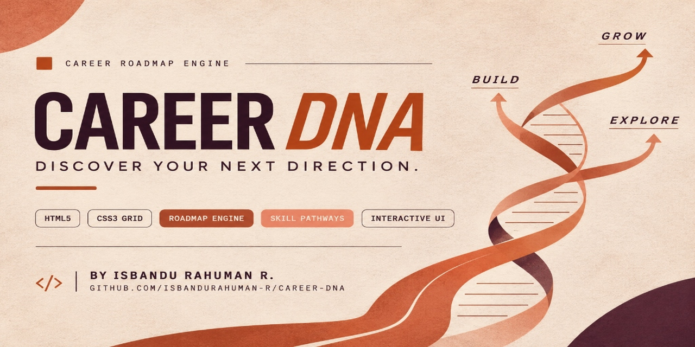
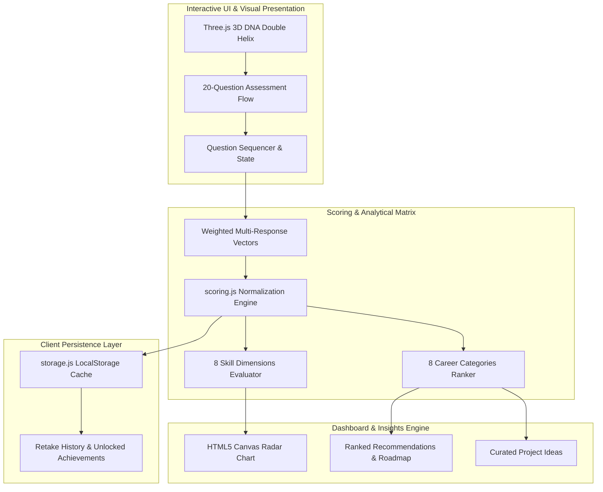

<p align="center">
  
</p>

# ◈ CAREER DNA — Career Discovery Engine

[](https://github.com/ISBANDURAHUMAN-R/CAREER-DNA/actions/workflows/ci.yml)

## ◆ About the Project
CAREER DNA is an interactive, client-side career discovery assessment designed to help users identify potential technical paths through their problem-solving and thinking preferences. By completing a 20-question multi-weighted quiz, users receive a personalized profile that ranks career matches, calculates dimensional strengths, and outlines learning roadmaps.

## ❖ Key Features
- 20-question sequential assessment interface with dynamic answer weighting across 8 career categories and 8 skill dimensions.
- Normalization scoring algorithm mapping cumulative answer weights into ranked career recommendations.
- Interactive results dashboard featuring an HTML5 Canvas radar chart, progress meters, and project ideas.
- Interactive Three.js 3D DNA double helix hero graphic responsive to cursor movement.
- LocalStorage client persistence retaining previous results, retake history, and unlocked achievements without requiring account creation.

## ◆ System Architecture


## ⬢ Technologies Used
- HTML5 & CSS3
- JavaScript (ES6+ Vanilla)
- Three.js (r128)
- GSAP (GreenSock Animation Platform)
- HTML5 Canvas API

## § Requirements
- Modern web browser

## ▲ Installation & Execution
```bash
# Serve locally via Python
python -m http.server 8080

# Or serve via Node.js
npx serve .
```
Open `http://localhost:8080` in your web browser.

## ※ Developer
Developer: ISBANDU RAHUMAN R  
GitHub: https://github.com/ISBANDURAHUMAN-R
